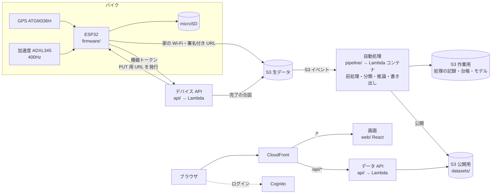

# drive-logger

ハンターカブ CT125 に載せた ESP32 のロガーで、走行中の **GPS と振動（加速度 400Hz）** を記録し、
AWS で前処理・異常スコアの計算をして、**地図とタイムラインで見る** までを一本につないだ個人プロジェクトです。

- 公開先：https://drive.herdio-system.com/ （ログインが必要）
- 記録 → クラウド → 画面 のすべてを、このリポジトリ 1 つに入れています



## 何をしているか

| 段階 | 中身 | 場所 |
|---|---|---|
| 記録 | ESP32 が GPS（1Hz）と加速度（400Hz）を microSD に書く。電源断に強い（1 秒ごとに確定） | `firmware/` |
| 送信 | 走行後、止まって静かになったら（または BOOT ボタン）、家の Wi-Fi で S3 に直接送る。機器は AWS の鍵を持たず、取り消せる機器トークンと 15 分だけ有効な URL だけを使う | `firmware/`、`api/`（デバイス API） |
| 前処理 | 1 秒窓の振動特徴量（RMS・p2p・crest・jerk・帯域比）と GPS の結合 | `pipeline/` |
| 異常スコア | 速度で補正した正常時のベースラインからの逸脱（z_speed）と Isolation Forest（scikit-learn） | `pipeline/` |
| 自動処理 | S3 に生データが届くと Lambda（コンテナ）が前処理 → 推論 → 画面用データの書き出し。学習し直しも Lambda で | `pipeline/src/ct125/cloud/` |
| 画面 | 走行一覧、地図（MapLibre）とタイムライン（ECharts）とスペクトログラムが連動する走行ページ | `web/` |
| 公開 | CloudFront＋Cognito のログイン、データ API（FastAPI） | `web/`、`api/`、`infra/` |
| インフラ | S3・CloudFront・ACM・Cognito・API Gateway・Lambda×3・ECR を Terraform で | `infra/` |

**言っていないこと**：健康な車両の走行データだけで学習しているので、これは「故障の予測」ではありません。
値の大きい区間は「路面または車両に起因する振動の変化」を示すもので、車両の異常と断定するものではありません（`docs/DEV_PLAN.md` 4.）。

## フォルダー

```
drive-logger/
├── README.md        このファイル
├── CLAUDE.md        Claude Code への作業ルール
├── docs/            計画（DEV_PLAN）・進捗（PROGRESS）・構成・データ仕様・設計
├── firmware/        ESP32（Arduino）。記録と Wi-Fi での送信。設定スクリプト
├── pipeline/        Python。前処理・異常スコア・画面用データの書き出し・AWS の自動処理（Lambda コンテナ）・機器の登録
├── api/             FastAPI。データ API（画面用、読むだけ）とデバイス API（機器用、raw/ に置くだけ）
├── web/             React＋Vite。走行一覧・走行ページ・ログイン
└── infra/           Terraform。AWS のリソース一式
```

それぞれのフォルダーに README があります。全体の構成は [docs/architecture.md](docs/architecture.md)。

## データの約束事

フォルダーの間は、次の「形」でつながっています。形は [contracts/](contracts/) に機械が読める定義（JSON Schema・Table Schema）として 1 か所だけ書き、
各フォルダーのコードがそれと合っているかを CI のテストで突き合わせます。片方を変えるときは、同じ PR でもう片方も直します。

| 約束 | 作る側 | 使う側 | 定義 | 説明 |
|---|---|---|---|---|
| SD の CSV と meta.json の形 | `firmware/` | `pipeline/` | [contracts/sd/](contracts/sd/) | [docs/data_spec_v2.md](docs/data_spec_v2.md) |
| 機器からの送信の手順 | `firmware/`（`uploader.cpp`）・PC のツール | `api/`（デバイス API） | [contracts/upload/](contracts/upload/) | [docs/device_upload_design.md](docs/device_upload_design.md) |
| 画面用 JSON の形 | `pipeline/`（`export.py`） | `web/`（`types.ts`）・`api/` | [contracts/app/](contracts/app/) | [web/docs/data_contract.md](web/docs/data_contract.md) |
| 走行の台帳・処理の記録・モデルの記録 | `pipeline/` | `api/`・`web/` | [contracts/records/](contracts/records/) | [docs/data_flow_design.md](docs/data_flow_design.md) |
| AWS の名前・場所 | `infra/` | 各フォルダーのスクリプト（Terraform の出力を読む） | `infra/outputs.tf` | `infra/README.md` |

## コミットしないもの

PC ごとの設定（`pipeline/config/local.yaml`）、
`.env.local`、`terraform.tfvars`（ユーザーのパスワードを含む）、機器トークン（`*.token`）。
Wi-Fi のパスワードと機器トークンは ESP32 の内部フラッシュにだけ置きます。
Terraform の state はコミットせず、非公開の S3 に置いています（どの PC からも同じ state を使う）。
走行データは S3 にだけ置き、手元にデータのフォルダーは作りません（手元で処理するときも S3 から読み、S3 に書く）。

## 別の PC で開発する

クローンして、秘密の情報（AWS のログインと `infra/terraform.tfvars`）といくつかの設定ファイルを置けば動きます。
手順は [docs/setup_another_pc.md](docs/setup_another_pc.md)。

## 動かし方（概要）

| やりたいこと | コマンド（リポジトリのルートから） |
|---|---|
| 画面をローカルで触る | `start.bat`（ダブルクリックでよい。PowerShell なら `.\start.ps1`。中身は `web/scripts/start-dev.ps1` で、`web/start.bat` と同じ。または `cd web; npm run dev`。公開版と同じログイン。`web/docs/local_dev.md`） |
| 解析をローカルで流す | `cd pipeline; .venv/Scripts/python -m ct125 process --ride <走行>`（S3 から読み、作業用に結果を置く。画面に出すのは `publish`） |
| PC から SD の走行を送る | `cd pipeline; .venv/Scripts/python -m ct125 upload-sd E:/sessions`（ESP32 と同じデバイス API。同じ走行は 2 回受け付けない） |
| 走行の台帳を見る | `cd pipeline; .venv/Scripts/python -m ct125 rides`（消す・戻すは画面の admin のボタン） |
| AWS のリソースを作る・変える | `terraform -chdir=infra apply` |
| 画面を公開する | `web/scripts/deploy.ps1` |
| データ API を更新する | `api/scripts/build-lambda.ps1` → `terraform -chdir=infra apply` |
| 自動処理のコンテナを更新する | `pipeline/scripts/build-pipeline-image.ps1` → `terraform -chdir=infra apply` |
| ファームウェアを書き込む | `firmware/ct125_logger/README.md` の「書き込み方」 |

## 自動のテスト（CI）

PR と main への push ごとに、GitHub Actions が次を回します（AWS には繋がず、鍵も置いていません）。

| 対象 | 中身 | 設定 |
|---|---|---|
| pipeline | pytest（Lambda のコンテナと同じ版のライブラリで） | `.github/workflows/ci.yml` |
| api | pytest（`uv.lock` の版で） | 同上 |
| web | 型チェックとビルド（画面用 JSON の見本と型の突き合わせを含む） | 同上 |
| infra | `terraform fmt -check` と `terraform validate`（backend なし） | 同上 |
| contracts | 定義が正しいか、見本が定義に合うか、firmware のソースの定数が定義と同じか | 同上 |
| firmware | ESP32 のコンパイル（firmware/ を変えたときだけ） | `.github/workflows/firmware.yml` |
| pipeline のコンテナ | Lambda のコンテナを作り、入口が読み込めるか（pipeline/ を変えたときだけ。ECR には上げない） | `.github/workflows/pipeline-image.yml` |

## 技術

ESP32（Arduino、FreeRTOS、mbedTLS）／ Python 3.12（pandas・numpy・scikit-learn・pyarrow）／
FastAPI＋Mangum ／ React 19・TypeScript・Vite・Tailwind・MapLibre・ECharts ／ amazon-cognito-identity-js ／
AWS（S3・CloudFront・ACM・Cognito・API Gateway・Lambda（zip とコンテナ）・ECR・SSM・CloudWatch Logs）／ Terraform ／ Docker
