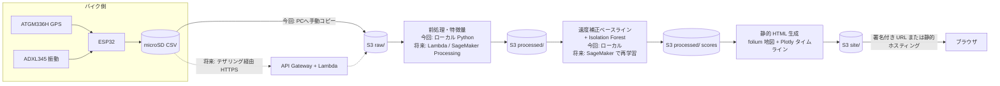

# CT125 データロガー 開発計画書（Claude Code 用）

- 作成日：2026-11-06
- 対象：ハンターカブ CT125（JA55）の走行データ（GPS＋振動）を、ローカル解析 → 地図・タイムライン可視化 → AWS 最小構成 へつなぐポートフォリオ
- 読み手：Claude Code（この文書を最初に読み、フェーズ 0 から順に進める）

---

## 0. この文書の使い方（Claude Code へ）

1. 作業開始前に本文を最後まで読むこと。特に **4. 表現上の制約** と **7. 作業ルール** は全フェーズに効く。
2. フェーズは番号順に進める。各フェーズに「完了条件」があり、満たすまで次へ進まない。
3. **フェーズ 0 で実データの列構成を確認するまで、特徴量・モデルのコードは書かない。** この文書に書いた列名・サンプリング周波数は推定であり、実データが正。
4. 不明点は推測で埋めずに、`docs/QUESTIONS.md` に箇条書きで残して先へ進める（止まらない）。ユーザーが後で答える。
5. 各フェーズ完了時に `git commit` し、`docs/PROGRESS.md` に「できたこと／できなかったこと／次にやること」を 5 行以内で追記する。

---

## 1. 目的とスコープ

### 1.1 最終的に作りたいもの（ゴール像）

- バイクに載せた ESP32 が GPS と加速度（振動）を記録する
- そのデータを AWS に集め、前処理 → 特徴量 → 異常検知モデル の流れを回す
- Web 上で「地図のどこで、どのくらいの振動だったか」を色付きの軌跡とタイムラインで見られる
- GPS が取れなかった走行は地図なしで時間軸タイムラインだけを表示する（欠損時の設計）

### 1.2 最初の版のスコープ

> **2026-11-07 追記：1.2 と 2. は目安であり、ルールではない。** 作業は 1.1 のゴール像の全体から考え、今できる最善の方法を選ぶ。「やらない」に挙げた項目も、よりよい方法なら選択肢として検討する。ただし ECU / K-Line に触れないことと、4.（表現上の制約）は引き続き守る。

**やる（Must）**
- 既存の走行ログ 2 本の棚卸しとスキーマ確定
- ローカルで動く解析パイプライン（CSV → クリーニング → 1 秒窓の特徴量 → GPS 結合）
- 速度補正ベースライン＋ Isolation Forest による異常スコア
- 静的 HTML の地図（folium/Leaflet）とタイムライン（Plotly）
- S3 への生データ・処理済みデータ・HTML のアップロードと、人に見せられる URL
- 構成図（Mermaid）と日本語 README

**やらない（今回は対象外）**
- **ECU / K-Line 接続は完全にスコープ外。** 基板上に L9637D 等の部品が載っているが、関連コードがあっても触らない・読み出しを試みない・削除もしない
- Google Maps JavaScript API（API キーと請求設定が必要なため後回し。今回は Leaflet/OpenStreetMap）
- 走行中のリアルタイム送信（Wi-Fi/テザリング）。設計だけ書く
- SageMaker での学習・チューニングの実装。設計と手順書まで
- 故障予測の精度主張（そもそもできない。**4. を参照**）

---

## 2. 優先度

### 2.1 優先度の判断基準

- 迷ったら「画面を見せて 1 分で説明できる状態」を優先する。精度や美しさより「一本つながっている」こと
- フェーズ 3 までが終われば、フェーズ 4 が未完でも見せられる（ローカルの HTML を見せればよい）
- 時間が足りないときに削る順番：Should（9.4 の帯域特徴量、10.3 のグリッド集計、11.3 の静的ホスティング）→ フェーズ 4 の自動化 → それでも足りなければ Isolation Forest を外して速度補正ベースラインだけにする

---

## 3. 現状と未確定事項

### 3.1 ハードウェア（ユーザー談。実測・確認済みでないものは「未確認」と明記）

| 部品 | 内容 | 備考 |
|---|---|---|
| マイコン | Freenove 製 ESP32 開発ボード（ESP32-WROOM/WROVER 系） | Wi-Fi（2.4GHz）と Bluetooth 内蔵。正確な型番は未確認 |
| GPS | ATGM336H | UART、NMEA 出力。既定 9600bps・1Hz と推定（未確認） |
| 加速度 | ADXL345（GY-291 モジュール） | I2C、ジャンパーワイヤー接続。測定レンジ（±2g〜±16g）と ODR の設定値は未確認 |
| 記録 | microSD（秋月 DIP 化キット 105488） | SPI |
| 電源 | USB モバイルバッテリー（cheero canvas 3200mAh） | 車両電源は使わない方針 |
| 取付 | ESP32 はタンク側面カウル内、センサーは約 20cm 離れたフレーム（構想） | 加速度センサーの軸と車体の前後・左右・上下の対応は未確認 |

> **実測（2026-11-06、フェーズ 0）**：GPS は 9600bps・1Hz で確定。ADXL345 は I2C 0x53、±16g フル分解能（3.9mg/LSB）、ODR 400Hz（実測 約398.5Hz）。11/02 の記録はブレッドボードを車体に置いた暫定固定。軸の対応は未記録（`docs/QUESTIONS.md` 10）。

### 3.2 ファームウェア

- GPS と加速度を SD に CSV で記録するスケッチが存在し、10/14 時点で動作している
- **言語・環境は未確認**（Arduino IDE の可能性が高いが、ESP-IDF の可能性もある）。フェーズ 0 で実物を読んで確定する
- 今回ファームは原則変更しない。変更が必要になるのはフェーズ 5

> **実測**：Arduino（ESP32 core 3.3.12）、`CT125_LOGGER_V2.1`。K-Line 関連コードはスケッチに存在しない。GGA の fix・衛星数・HDOP はすでに記録されている（フェーズ 5 の 1. は実装済み）。

### 3.3 データ

| ride_id（仮） | 内容 | GPS | 用途 |
|---|---|---|---|
| `ride_dentist_roundtrip` | 自宅〜歯医者の往復（市街地・短距離） | あり | 地図・タイムライン・モデルの主データ。往路と復路で同じ区間を通るため「同じ場所で同じ振動が出るか」の確認に使える |
| `ride_suburb_nogps` | 郊外を回った走行 | **なし**（原因未確認。コールドスタート直後に走り出した可能性） | 位置情報を使わない振動特徴量の学習データ、および「GPS 欠損時フォールバック表示」の検証データ |

- 実ファイル名・置き場所・列構成はフェーズ 0 で確認する。**CSV の列名・単位・時刻の基準は本文書では決め打ちしない**
- ESP32 に RTC はないため、時刻は `millis()` 相当の相対時間と、GPS 捕捉時の UTC の組み合わせになっている可能性が高い

> **実測**：記録は 9 本（`data/raw/ride_001`〜`ride_009`）。`ride_dentist_roundtrip` は **ride_004（往路 13.9 分、fix 率 0.95）と ride_005（復路 15.3 分、fix 率 0.90）の 2 本**。`ride_suburb_nogps` は **ride_007（37.4 分）と ride_009（31.1 分）**（ride_006・008 も GPS なし、短い）。ride_001〜003 はアイドリング・発進の短い試験。時刻は ESP32 の `esp_timer`（us）と GPS UTC の対応付け。GPS なし走行は先頭から最後まで衛星 0・UTC なし。詳細は `docs/data_schema.md`。

### 3.4 未確定事項（`docs/QUESTIONS.md` の初期内容にそのまま転記する）

1. CSV の列名・区切り・ヘッダーの有無。GPS と加速度が同一ファイルか別ファイルか
2. 加速度の実サンプリング周波数（タイムスタンプから実測する。推定 50〜200Hz）
3. 加速度の単位（raw LSB か g か m/s² か）と重力成分の含有（ADXL345 は静止時に約 1g が出る）
4. 加速度の測定レンジと ODR 設定（スケッチ内の設定値を読む）
5. 時刻列の種類（millis / GPS UTC / 両方）と、GPS 未捕捉時の時刻の扱い
6. GPS 列に fix 状態・衛星数・HDOP が含まれているか（なければフェーズ 5 で追加）
7. GPS の更新周期（1Hz 想定）と速度列（RMC の対地速度）の有無
8. 郊外走行で GPS が取れなかった原因（ログの先頭から最後まで無効なら電源投入直後の未捕捉が濃厚）
9. 自宅の座標（公開出力でマスクするために必要。ユーザーに聞く。リポジトリにはコミットせず `.env` か `config/local.yaml` に置く）

---

## 4. 表現上の制約（README・コメント・図・説明資料すべてに適用）

これは成果物の信頼性に直結する。**Claude Code が生成するあらゆる文章に適用する。**

### 4.1 言ってよいこと

- 「走行中の振動を位置と時刻に紐づけて可視化した」
- 「速度で補正した正常時のベースラインからの逸脱を異常スコアとして算出した」
- 「健康な車両の走行データで正常モデルを学習した。故障データは含まれていない」
- 「ECU 接続は端子・電圧・プロトコルが未検証で、今は安全に検証できないと判断し、動作している GPS と振動の 2 系統でパイプラインを完成させた」
- 「今後の拡張：fix 状態の記録、テザリング経由の自動送信、SageMaker での再学習、ECU 系統の追加」

### 4.2 言ってはいけないこと

- 「故障を予測できる」「故障予兆を検知した」「予知保全を実現した」（故障データが 1 件もないため主張不能）
- 「精度 XX%」（正解ラベルがないので精度は定義できない。出すなら「異常スコア上位 N 件を目視で確認した結果」と書く）
- 「ECU データを取得した」「K-Line で通信した」（未達）
- 振動の異常を「車両の異常」と断定すること。振動は路面の影響が支配的なので、まず「路面または車両に起因する振動の変化」と書く

---

## 5. 全体アーキテクチャ



- 実線＝今回実装、点線＝設計のみ（フェーズ 5）
- 「学習はローカルで作り、調整を AWS で行う」方針。今回はローカル完結で、AWS は保管と配信

---

## 6. リポジトリ構成

```
ct125-logger/
├── CLAUDE.md                 # 短い指示。本文書（docs/DEV_PLAN.md）を読めと書く
├── README.md                 # 日本語。目的・構成図・使い方・表現上の制約を反映
├── docs/
│   ├── DEV_PLAN.md           # この文書
│   ├── data_schema.md        # フェーズ 0 で作成。実データの列・単位・周波数
│   ├── QUESTIONS.md          # 未確定事項と、ユーザーへの質問
│   ├── PROGRESS.md           # フェーズごとの進捗メモ
│   ├── architecture.md       # Mermaid 構成図（5. を元に実装後の姿へ更新）
│   └── aws_setup.md          # フェーズ 4 で作成。S3 の手順と URL 発行方法
├── firmware/                 # 既存スケッチをコピー（参照用。原則変更しない）
├── data/
│   ├── raw/<ride_id>/        # SD からコピーした原本。絶対に書き換えない。.gitignore 対象
│   ├── interim/<ride_id>/    # クリーニング後（parquet）
│   └── processed/<ride_id>/  # 1 秒窓の特徴量＋スコア（parquet / csv）
├── config/
│   ├── default.yaml          # 窓幅、速度ビン幅、contamination、マスク半径などの既定値
│   └── local.yaml            # 自宅座標など。.gitignore 対象
├── src/ct125/
│   ├── __init__.py
│   ├── io.py                 # CSV 読み込み、時刻基準の統一、ride_id 付与
│   ├── clean.py              # 欠損・外れ値・重複の処理、GPS 妥当性チェック
│   ├── features.py           # 1 秒窓の振動特徴量
│   ├── gps.py                # 速度算出（haversine）、座標補間、自宅マスク
│   ├── model.py              # 速度補正ベースライン、Isolation Forest
│   ├── viz.py                # folium 地図、Plotly タイムライン、index.html 組み立て
│   ├── aws.py                # S3 アップロード、署名付き URL 発行
│   └── cli.py                # `python -m ct125 ...`
├── notebooks/
│   ├── 01_inspect.ipynb      # 生データの目視確認（フェーズ 0）
│   ├── 02_features.ipynb     # 特徴量の分布確認（フェーズ 1）
│   └── 03_model.ipynb        # モデルの妥当性チェック（フェーズ 2）
├── web/                      # 生成された HTML（出力先。生成物なので .gitignore でもよい）
├── tests/                    # 最低限：特徴量関数と速度算出の単体テスト
├── pyproject.toml            # Python 3.11+。依存は 7.2 参照
└── .gitignore
```

---

## 7. 作業ルール

### 7.1 一般

- `data/raw/` は読み取り専用として扱う。変換結果は必ず別ディレクトリへ
- 破壊的操作（ファイル削除、履歴書き換え、S3 の削除・公開設定変更）は実行前にユーザーに確認する
- 出力・コメント・README は日本語。識別子（変数名・関数名・列名）は英語
- 1 フェーズ 1 コミット以上。コミットメッセージ例：`phase1: 1秒窓の特徴量とGPS結合を実装`
- 設定値（窓幅、ビン幅、contamination、マスク半径）はコードに埋めず `config/default.yaml` に置く
- 自宅座標・AWS 認証情報はコミットしない。`.gitignore` で `config/local.yaml`、`.env`、`data/raw/`、`data/interim/`、`web/` を除外

### 7.2 技術スタック（Python）

- Python 3.11 以上、仮想環境は `uv` または `venv`
- pandas、numpy、scipy（FFT）、scikit-learn（IsolationForest）、pyarrow（parquet）
- folium（地図）、plotly（タイムライン）、pyyaml、boto3
- Jupyter はローカル確認用。再現性はスクリプト側（`src/ct125`）で担保し、ノートブックは薄く保つ
- 標準ライブラリで済むものに外部依存を増やさない

### 7.3 テスト

- `tests/test_features.py`：既知の正弦波を入力して RMS・ピークが理論値に一致すること
- `tests/test_gps.py`：既知 2 点間の haversine 距離が正しいこと、速度の単位変換（knot→km/h は ×1.852）
- フェーズ 1 完了条件に含める。網羅は不要

---

## 8. フェーズ詳細

### フェーズ 0：リポジトリ整備とデータ棚卸し（目安 0.5 日）

**目的**：実データとファームを正確に把握し、以降の作業の前提を固定する。

**作業**
1. 6. の構成でリポジトリを初期化（git、pyproject、.gitignore、空の docs ファイル）
2. ユーザーに既存スケッチと SD の CSV の置き場所を聞き、`firmware/` と `data/raw/<ride_id>/` にコピー
3. スケッチを読み、以下を `docs/data_schema.md` に書く：言語・環境、GPS のボーレートと更新周期、ADXL345 のレンジ・ODR・I2C アドレス、SD 書き込みの形式、時刻の生成方法（millis か GPS 時刻か）、**K-Line 関連コードの有無（あっても触らないと明記）**
4. `notebooks/01_inspect.ipynb` で 2 本の CSV を読み、以下を確認して `data_schema.md` に追記：
   - 列名、型、行数、先頭 5 行
   - 加速度の実サンプリング周波数（連続するタイムスタンプ差の中央値から算出）
   - 加速度の値域（重力を含むか、単位は何か）
   - GPS の有効行割合（`gps_fix_ratio`）、更新周期、座標の範囲（熊本市内に収まるか）
   - 時刻の単調増加、欠損・重複・ファイル分割の有無
5. 3.4 の未確定事項を `docs/QUESTIONS.md` に転記し、調べて分かったものは回答を書き、分からないものはユーザーへの質問として残す

**成果物**：`docs/data_schema.md`、`docs/QUESTIONS.md`、`notebooks/01_inspect.ipynb`

**完了条件**
- 2 本のデータそれぞれについて「列、単位、周波数、時刻基準、GPS 有効割合」が文章で説明できる
- `data_schema.md` に「特徴量計算に使う列」と「捨てる列」が決まっている

**注意**：ここで分かった事実が本文書の推定と食い違う場合、**実データを優先し、本文書の該当箇所に「実測: …」と追記する**（本文書を書き換えてよい）。

---

### フェーズ 1：ローカル解析パイプライン（目安 1 日）

**目的**：CSV から 1 秒窓の特徴量テーブルを再現可能に作る。

**作業**
1. `io.py`：ride_id を付けて CSV を読む。時刻基準を統一する
   - GPS 捕捉中：GPS の UTC を絶対時刻とする（表示は JST に変換）
   - GPS なし：`t_rel`（走行開始からの秒）のみ。絶対時刻列は NaN
   - 両方ある走行では「最初の fix 時刻 − その時点の millis」でオフセットを求め、全行に絶対時刻を付ける
2. `clean.py`：
   - 加速度：明らかな外れ値（レンジ上限の張り付き）をフラグ、重複タイムスタンプの処理
   - GPS：緯度経度が 0 や範囲外の行を無効化、1 秒で 50m 以上飛ぶ点を無効化（時速 180km 超相当）
   - 走行開始・終了の各 60 秒は `is_edge=True` でフラグ（停車・取り回しのノイズ）
3. `gps.py`：
   - 速度：RMC の対地速度列があればそれを使い、なければ連続 fix 間の haversine 距離 ÷ 経過秒。3 点の移動中央値で平滑化。単位 km/h
   - 補間：1 秒窓の中心時刻に対して直近 fix を線形補間で割り当て。fix 間隔が 5 秒を超える区間は補間せず `has_gps=False`
   - 自宅マスク：`config/local.yaml` の自宅座標から半径 R（既定 300m）以内の窓に `is_private=True`
4. `features.py`：9. の仕様で 1 秒窓の特徴量を計算
5. `cli.py`：`python -m ct125 process --ride ride_dentist_roundtrip` で `data/processed/<ride_id>/windows.parquet` を出力
6. `notebooks/02_features.ipynb`：特徴量の分布、速度との散布図を目視

**成果物**：`src/ct125/{io,clean,gps,features,cli}.py`、`data/processed/*/windows.parquet`、`tests/`

**完了条件**
- 2 本の走行で `process` が通り、`windows.parquet` に 9.3 の列が揃う
- 歯医者往復で `has_gps=True` の窓が大半、郊外走行で全窓 `has_gps=False` になっている
- RMS と速度の散布図で、速度が上がるほど RMS が上がる傾向が見える（見えなければ `QUESTIONS.md` に記録。センサー設定やノイズの問題を疑う）
- `tests/` が通る

---

### フェーズ 2：モデル（目安 1 日）

**目的**：「速度で補正した正常ベースラインからの逸脱」を異常スコアとして出す。

**作業**
1. `model.py`：
   - **速度補正ベースライン**：速度を 5km/h 幅でビン分け。各ビンで `log_rms` の中央値と MAD（中央絶対偏差）を計算。各窓の `z_speed = (log_rms − 中央値) / (1.4826 × MAD)`。`z_speed > 3` を候補異常
   - **Isolation Forest**：入力は 9.3 の特徴量＋速度（GPS なし走行は速度を欠損として別モデル、または速度抜きの特徴量だけで学習）。`contamination` は既定 0.03。`score_if` は `decision_function` の符号反転（大きいほど異常）
   - 学習データ：`is_edge=False` の全窓。GPS なし走行も振動特徴量だけなら使える
2. `notebooks/03_model.ipynb` で 9.5 の妥当性チェックを実施し、結果を `docs/PROGRESS.md` に要約
3. スコア付きテーブルを `data/processed/<ride_id>/scored.parquet` に保存

**成果物**：`src/ct125/model.py`、`scored.parquet`、`notebooks/03_model.ipynb`

**完了条件**
- 2 種類のスコア（`z_speed`、`score_if`）が全窓に付いている
- 9.5 のチェック 3 項目を実施し、結果（期待どおりか、そうでないか）が文章で残っている
- 画面で見せる主スコアを 1 つ決めている（既定は `z_speed`。説明しやすく、ラベルなしでも意味が明確）

**注意**：精度指標（precision 等）は計算しない。正解がないため意味を持たない。

---

### フェーズ 3：可視化と Web 出力（目安 0.5〜1 日）

**目的**：地図とタイムラインを静的 HTML として出力する。GPS 欠損時のフォールバックを含む。

**作業**
1. `viz.py`：10. の仕様で `web/<ride_id>/index.html` を生成
2. `cli.py` に `python -m ct125 render --ride <ride_id>` を追加
3. `web/index.html`：走行一覧（ride_id、日時、距離、GPS 有無、異常窓数）から各走行ページへリンク
4. GPS なし走行（`ride_suburb_nogps`）で地図が出ず、タイムラインと注意書きが出ることを確認

**成果物**：`src/ct125/viz.py`、`web/index.html`、`web/<ride_id>/index.html`

**完了条件**
- ブラウザで開いて、歯医者往復は地図＋タイムライン、郊外走行はタイムラインのみ＋「GPS 未捕捉」の表示になる
- 地図上の色と、タイムラインのピークが対応している（同じ窓を指している）
- 自宅マスク済みの窓が地図に描かれていない

---

### フェーズ 4：AWS 最小構成（目安 0.5 日）

**目的**：データと HTML を S3 に置き、人に見せられる URL を用意する。

**作業**
1. `docs/aws_setup.md` に手順を書く（バケット作成、IAM 最小権限、リージョンは `ap-northeast-1`）
2. `aws.py`：`python -m ct125 upload --ride <ride_id>` で `raw/`、`processed/`、`site/` へ同期（`boto3` の `upload_file`。差分同期は不要）
3. 配信方法は **署名付き URL を既定**にする（バケットを公開しない。自宅周辺マスクをしていても公開は最小限にする）
   - `python -m ct125 share --ride <ride_id> --expires-hours 72` で `site/<ride_id>/index.html` の署名付き GET URL を発行
   - 署名付き URL の有効期限上限は 7 日。**見せる前に発行し直す手順を `aws_setup.md` に書く**
   - 静的ウェブサイトホスティング（公開）は Should。やる場合はユーザーに確認してから
4. `docs/architecture.md` を実装後の姿に更新し、README に構成図と「今回実装／将来」を明記

**成果物**：`docs/aws_setup.md`、`src/ct125/aws.py`、`README.md`、`docs/architecture.md`

**完了条件**
- S3 に `raw/<ride_id>/`、`processed/<ride_id>/`、`site/<ride_id>/index.html` がある
- 署名付き URL をスマホのブラウザで開いて地図が表示される
- README を読めば第三者が「何を・なぜ・どうやって」作ったか分かる（4. の制約を守った文章で）

---

### フェーズ 5：今後の拡張（設計のみ。最初の版では実装しない）

優先順に並べる。各項目は「何を・なぜ・どう」を `docs/roadmap.md` に 3〜5 行ずつ書く。

1. **ファーム：fix 状態の記録**。GGA の fix 品質・衛星数・HDOP を列に追加。GPS 欠損の原因切り分けに必須。合わせて「出発前に fix を待つ」運用手順を書く
2. **ファーム：サンプリングの固定**。タイマー割り込みで加速度を一定周期で取得（SD 書き込みのジッタを分離）。走行ごとにファイルを分ける
3. **自動送信**：スマホのテザリング SSID に ESP32 を接続し、走行後に SD の未送信ファイルを HTTPS POST で API Gateway（HTTP API）→ Lambda → S3 `raw/` へ。走行中のリアルタイム送信はその次
4. **AWS 側の処理**：S3 `raw/` への PUT をトリガーに Lambda でフェーズ 1 相当の前処理を実行。データ量が増えたら SageMaker Processing / Training へ移し、モデルの再学習と `contamination` 等の調整をクラウド側で行う
5. **Web 本番版**：TypeScript のフロントで Google Maps JavaScript API に差し替え（API キー・請求設定が前提）。走行一覧 → 地図 → 時刻をクリックで該当窓の詳細
6. **ECU 系統**：K-Line の端子・電圧・極性・プロトコルを実車で検証してから。安全確認が取れるまで手を付けない

---

## 9. 特徴量・モデルの仕様

### 9.1 前提

- 窓幅 1.0 秒、重なりなし（`config/default.yaml` の `window_sec`）。サンプリング周波数 fs は実測値を使う
  - **実測**：fs ≈ 398.5Hz（走行ごとに 397.5〜400.2Hz）。1 秒窓 ≈ 398 サンプル。単位は g（重力込み）なので raw→g の変換は不要
- 重力の除去：各窓で 3 軸それぞれの平均を引く（走行中の姿勢変化が 1 秒内で小さい前提）。軸の向きが未確認のため、主に **合成加速度の大きさ** `|a| = sqrt(ax²+ay²+az²)` の変動を使う。軸別の特徴量は補助
- 単位は実データに合わせる。raw LSB の場合は `data_schema.md` のスケール係数で g に変換してから計算

### 9.2 1 秒窓ごとの振動特徴量（Must）

| 列名 | 定義 |
|---|---|
| `rms` | 重力除去後の `|a|` の二乗平均平方根 |
| `log_rms` | `log(rms + 1e-6)`（ベースライン用。分布を対称に近づける） |
| `p2p` | `|a|` の最大 − 最小 |
| `std` | `|a|` の標準偏差 |
| `crest` | `max(|a|) / rms`（突発的な衝撃を拾う） |
| `jerk_rms` | `|a|` の 1 階差分の RMS × fs（急激な変化） |
| `n_samples` | 窓内サンプル数（fs のばらつき・欠損の検知用） |

### 9.3 `windows.parquet` の列（フェーズ 1 の出力）

`ride_id, t_rel, t_abs(JST, nullable), lat, lon, has_gps, speed_kmh, is_edge, is_private, rms, log_rms, p2p, std, crest, jerk_rms, n_samples` ＋ 9.4 の列（実装した場合）

### 9.4 帯域特徴量（Should。fs ≥ 100Hz のときのみ）

- 窓内 `|a|` の FFT（Hann 窓）から、`band_1_5`、`band_5_15`、`band_15_40`（Hz）の帯域エネルギー比（合計で正規化）
- ナイキスト周波数 fs/2 を超える帯域は作らない。fs が 100Hz 未満なら実装しない（`QUESTIONS.md` に理由を書く）
- **実測**：fs ≈ 398Hz（ナイキスト ≈ 199Hz）なので実装する

### 9.5 妥当性チェック（フェーズ 2。精度ではなく「筋が通っているか」の確認）

1. **速度との関係**：`log_rms` と `speed_kmh` の散布図で正の傾向があるか。なければセンサー設定・固定方法・サンプリングを疑う
2. **往路・復路の一致**：歯医者往復を約 20m のグリッドに切り、同じグリッドを通った往路と復路の `rms` の中央値を比較。相関が正であれば「場所に由来する振動を拾えている」と言える
3. **上位異常の目視**：`z_speed` 上位 10 窓を地図に出し、ユーザーに「段差・マンホール・踏切・工事区間など心当たりがあるか」を確認してもらう。結果を表にして `PROGRESS.md` に残す（心当たりがない窓は「原因不明」と書く）

---

## 10. 可視化・Web 出力の仕様

### 10.1 走行ページ `web/<ride_id>/index.html`

- 上段：地図（folium / Leaflet、OpenStreetMap タイル）
  - 軌跡を 1 秒窓ごとの線分で描き、`log_rms` の 5 分位で 5 段階に色分け（青→黄→赤）
  - `z_speed > 3` の窓を赤い丸マーカーで重ねる
  - マーカーのポップアップ：JST 時刻、速度、rms、z_speed、score_if
  - `is_private=True` の窓は描かない（線もマーカーも）
- 下段：タイムライン（Plotly）
  - 横軸は時刻（`t_abs` があれば JST、なければ `t_rel` 秒）
  - 系列：`rms`、`speed_kmh`（第 2 軸）、`z_speed`。異常窓は縦の薄い帯で強調
- 1 ファイルに自己完結させる（Plotly は CDN 読み込みで可。folium の出力 HTML と Plotly の `to_html` を 1 つの HTML に組み立てる）

### 10.2 GPS 欠損時のフォールバック

- 走行全体の `gps_fix_ratio` が 10% 未満：地図を描かず、冒頭に「この走行は GPS が捕捉できなかったため地図は表示していません。タイムラインのみ表示します」と出す
- 部分欠損：fix のある窓だけ地図に描き、欠損区間は線をつながない。タイムラインには `has_gps` を薄い帯で示す
- 判定ロジックは `viz.py` に関数として切り出し、テストを 1 つ書く

### 10.3 グリッド集計レイヤー（Should）

- 約 20m のグリッドで `rms` の中央値を集計し、半透明の四角で重ねる「路面の荒さマップ」。往路・復路の平均化に使える

---

## 11. AWS 最小構成の仕様

### 11.1 バケット構成

```
s3://ct125-logger-<ランダム接尾辞>/
├── raw/<ride_id>/<元ファイル名>.csv
├── processed/<ride_id>/windows.parquet
├── processed/<ride_id>/scored.parquet
├── models/<yyyymmdd>/baseline.json       # 速度ビンごとの中央値・MAD
├── models/<yyyymmdd>/isolation_forest.pkl
└── site/<ride_id>/index.html
```

### 11.2 権限と設定

- 専用 IAM ユーザー（またはロール）に、このバケットへの `s3:PutObject`、`s3:GetObject`、`s3:ListBucket` のみ
- バケットは **パブリックアクセスブロック有効のまま**。配信は署名付き URL
- 認証情報は `~/.aws/credentials` のプロファイル `ct125` を使い、リポジトリには置かない
- コスト：S3 と署名付き URL だけなら実質無料枠内。SageMaker のノートブックインスタンスは起動したままにしない（フェーズ 5 の注意として明記）

### 11.3 静的ホスティング（Should）

- やる場合は `site/` だけを別バケットにし、CloudFront ＋ OAC で配信する（バケット自体は公開しない）。ユーザーの確認後に着手

---

## 12. 成果物チェックリスト

- [ ] `web/ride_dentist_roundtrip/index.html`：地図に色付き軌跡と異常マーカー、下にタイムライン
- [ ] `web/ride_suburb_nogps/index.html`：地図なし、注意書きあり、タイムラインあり
- [ ] 署名付き URL をスマホで開ける
- [ ] `docs/architecture.md` の構成図（今回実装／将来を区別）
- [ ] `README.md`：目的、ハード構成、処理の流れ、できたこと、できていないこと（ECU は未検証で切り捨てた判断と理由）、今後
- [ ] `docs/PROGRESS.md` に 9.5 の妥当性チェック結果（上位異常の心当たり表を含む）
- [ ] 4.2 の禁止表現が成果物のどこにもない（`grep` で「故障予測」「予知保全」「精度」「ECU データ」を確認）

---

## 13. Claude Code への最初の指示（コピペ用）

```
docs/DEV_PLAN.md を最後まで読んでから作業を始めてください。
今日はフェーズ 0 だけを進めます。

1. 6. の構成でリポジトリを初期化してください。
2. 既存の ESP32 スケッチは <パス> に、SD の CSV は <パス> にあります。firmware/ と data/raw/ にコピーしてください。
3. スケッチと CSV を読み、docs/data_schema.md と docs/QUESTIONS.md を作ってください。
4. 列名・サンプリング周波数・時刻基準・GPS 有効割合が確定するまで、特徴量やモデルのコードは書かないでください。
5. 分からないことは推測せず QUESTIONS.md に残して進めてください。
6. 終わったら docs/PROGRESS.md に 5 行以内でまとめ、コミットしてください。
```

`<パス>` はユーザーが埋める。`CLAUDE.md` には次の 3 行だけ書いておく：

```
- 作業前に docs/DEV_PLAN.md を読むこと
- 4.（表現上の制約）と 7.（作業ルール）は必ず守ること
- ECU / K-Line 関連には触れないこと
```

---

## 14. 判断に迷ったときの優先順位

1. 安全（車両・基板を壊さない。ECU には触れない）
2. 正直さ（4. の制約。できていないことを「できた」と書かない）
3. 一本つながっていること（CSV → 特徴量 → スコア → 地図/タイムライン → S3）
4. 再現性（スクリプトで再実行できる。設定は yaml）
5. 精度・見た目（最後）
