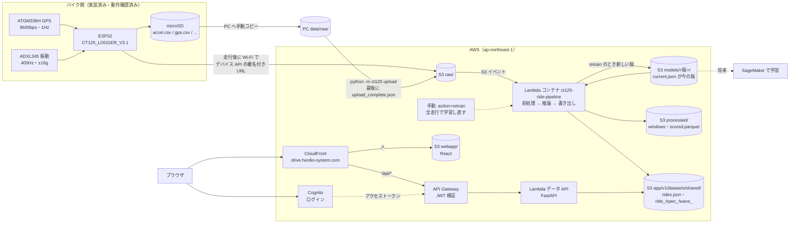

# 構成図（2026-11-09 時点）

実線＝実装済み、点線＝設計のみ（今後の拡張）。

> **作り直しの設計（2026-11-09）**：データの流れを、S3 を中心にした 1 本に作り直す（Epic #1）。
> バケットを役割ごとに分け、処理の記録・走行の台帳・走行の分類・モデルの記録を足す。
> 作り直した後の姿は [data_flow_design.md](data_flow_design.md)。下の図は今の構成。

## 実装したもの

| 段階 | 実装 | 場所 |
|---|---|---|
| 記録・送信 | ESP32 Arduino スケッチ（V3.1）。GPS と加速度を別 CSV、時計は `t_us`。走行後に Wi-Fi でデバイス API から S3 へ送る | `firmware/ct125_logger/`、`api/`（デバイス API） |
| 読み込み・時刻 | `t_us` と GPS UTC の対応付け、JST | `pipeline/src/ct125/io.py` |
| クリーニング | 重複・振り切れ、GPS の status/sats/hdop/飛び/速度不整合 | `pipeline/src/ct125/clean.py` |
| 特徴量 | 1 秒窓の振動特徴量、帯域比 | `pipeline/src/ct125/features.py` |
| GPS 結合 | 速度の平滑化、窓中心への補間 | `pipeline/src/ct125/gps.py` |
| 前処理の本体 | 上の 4 つを 1 走行分まとめる（CLI と Lambda の両方から使う） | `pipeline/src/ct125/processing.py` |
| スコア | 速度補正ベースライン、Isolation Forest。学習（`fit_models`）と推論（`apply_models`）を分けてある | `pipeline/src/ct125/model.py` |
| 画面用データ | rides.json・ride_<id>.json・スペクトログラム・生波形。1 走行ずつ書き出せる（`export_ride`） | `pipeline/src/ct125/export.py`・`spectro.py` |
| AWS の処理 | S3 に生データが届いたら Lambda（コンテナ）が前処理 → 推論 → 書き出し → 公開。手動で学習し直し | `pipeline/src/ct125/cloud/`、`pipeline/deploy/lambda/`、`pipeline/scripts/build-pipeline-image.ps1` |
| 公開 | CloudFront＋Cognito ログイン＋データ API（FastAPI） | `web`（フロントと `api/`） |
| AWS のリソース | S3・CloudFront・Cognito・API Gateway・Lambda×2・ECR・ACM（Terraform） | `infra` |

## 自宅の位置

自宅の位置は見えてもよいと決めた（2026-11-09、#13）。前は自宅周辺 300 m の窓の座標を書き出さず、SSM に置いた地点で書き出した後に検査していたが、その仕組みは外した。

## 設計のみ（今後）

- SageMaker での学習（今は Lambda の `retrain` で十分な量。データが増えたら移す）
- ユーザーごとのデータセット（入口は `api\src\ct125_api\services\dataset_resolver.py`。今は全員 shared）
- ECU 系統：端子・電圧・プロトコルが未検証で安全に検証できないと判断し、触れていない
