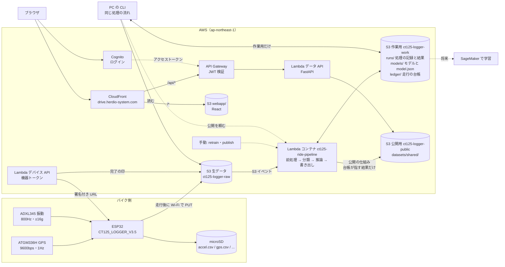

# 構成図

実線＝実装済み、点線＝設計のみ（今後の拡張）。

データの流れは S3 を中心にした 1 本で、バケットを役割ごとに分けている（生データ・作業用・公開用）。
処理の記録・走行の台帳・走行の分類・モデルの記録を持つ。設計は [data_flow_design.md](data_flow_design.md)。

## 実装したもの

| 段階 | 実装 | 場所 |
|---|---|---|
| 記録・送信 | ESP32 Arduino スケッチ（V3.5）。GPS と加速度を別 CSV、時計は `t_us`。走行後に Wi-Fi でデバイス API から S3 へ送る | `firmware/ct125_logger/`、`api/`（デバイス API） |
| 読み込み・時刻 | `t_us` と GPS UTC の対応付け、JST | `pipeline/src/ct125/io.py` |
| クリーニング | 重複・振り切れ、GPS の status/sats/hdop/飛び/速度不整合 | `pipeline/src/ct125/clean.py` |
| 特徴量 | 1 秒窓の振動特徴量、帯域比 | `pipeline/src/ct125/features.py` |
| GPS 結合 | 速度の平滑化、窓中心への補間 | `pipeline/src/ct125/gps.py` |
| 前処理の本体 | 上の 4 つを 1 走行分まとめる（CLI と Lambda の両方から使う） | `pipeline/src/ct125/processing.py` |
| スコア | 速度補正ベースライン、Isolation Forest。学習（`fit_models`）と推論（`apply_models`）を分けてある | `pipeline/src/ct125/model.py` |
| 画面用データ | rides.json・ride_<id>.json・スペクトログラム・生波形。1 走行ずつ書き出せる（`export_ride`） | `pipeline/src/ct125/export.py`・`spectro.py` |
| 走行の分類 | 机上・停車・実走・実走（GPS なし）。学習に使う走行と、画面に出す走行を決める | `pipeline/src/ct125/classify.py` |
| 処理の流れ | process・retrain・publish。ローカルの CLI と Lambda が同じものを呼ぶ。処理の記録（run.json）・走行の台帳・モデルの記録（model.json） | `pipeline/src/ct125/flow.py`・`records.py`・`models.py`・`storage.py` |
| AWS の処理 | 生データが届いたら Lambda（コンテナ）が処理して公開。手動で学習し直し・公開 | `pipeline/src/ct125/cloud/`、`pipeline/deploy/lambda/`、`pipeline/scripts/build-pipeline-image.ps1` |
| 公開 | CloudFront＋Cognito ログイン＋データ API（FastAPI） | `web`（フロントと `api/`） |
| AWS のリソース | S3（画面・生データ・作業用・公開用）・CloudFront・Cognito・API Gateway・Lambda×3・ECR・ACM・IAM（ローカルの処理のロール）（Terraform） | `infra` |
| test の環境 | 同じ Terraform を workspace と変数で本番と test の 2 つにし、名前で分ける（#26・#83） | `infra/environment.tf`、[test_environment.md](test_environment.md) |

## 位置情報

座標は、GPS のある窓ならそのまま画面用データに書き出す（2026-11-09、#13）。前は特定の地点の周り 300 m の窓の座標を書き出さず、書き出した後にも検査していたが、その仕組みは外した。

## 設計のみ（今後）

- SageMaker での学習（今は Lambda の `retrain` で十分な量。データが増えたら移す）
- ユーザーごとのデータセット（入口は `api/src/ct125_api/services/dataset_resolver.py`。今は全員 shared。#25 で、当面は分けないと決めた）

## 判定の差し替えの方針（#76 で決定、2026-11-10）

画面の「基準を超えた振動」の判定は、今は z_speed（速度ごとの中央値と MAD から求めた外れ。統計の式）で出している。これを次の形の機械学習のモデルに差し替える。実装は #81（`model.anomaly_method: speed_iforest` で切り替える）。既定は `speed_baseline`（`pipeline/config/default.yaml`）のままで、切り替えるかは 1 走行ずつ抜いた確かめ（`python -m ct125 evaluate`）の結果を見て決める。

- モデル：Isolation Forest に**速度を特徴量として足し**、振動が**いつもより大きい側だけ**を判定にする。速度を使わずに学習すると、速く走った所（もともと振動が大きい所）や、静かすぎる所を拾ってしまうため（#81 より前の版はこの形）。学習・保存・版の切り替えの仕組みは、前の Isolation Forest と同じものを使う。GPS が無い走行は速度が分からないので、判定しない
- しきい値：学習に使った 1 秒のスコアの分位点（上位 0.1% など。割合は `pipeline/config/default.yaml`）を、モデルと一緒に `model.json` に保存する。モデルの種類を問わず同じ決め方で済み、画面は保存した値を出すだけで済む
- 確かめ方：正解のラベルが無いので、1 走行を抜いて学習し、抜いた走行にスコアを付けることを走行の数だけ繰り返す。そのうえで上位 N 件を目で見る（[analysis_policy.md](analysis_policy.md) 1.2）。しきい値を超えた数が、学習のときと大きくずれないかも見る。学習に使った走行にそのままスコアを付けるだけでは、新しい走行でどうなるかが分からないため
- 画面用データの判定の方法（`anomaly.method`）に新しい値を足すだけにし、画面は直さずに済むようにする
- 保存形式は skops にする（#23。[data_flow_design.md](data_flow_design.md) の 10.）
- 採用しなかった案：速度の区間ごとに Isolation Forest を作る（区間ごとの学習の窓が少なくなり、モデルが不安定になる。決めたときのデータでは、20 区間に分けると 1 区間 70 秒ほどだった）
- 採用しなかった案：自己符号化器など別の種類のモデル（依存が増えて Lambda のコンテナが大きくなる。決めたときのデータの量では学習が足りない）
- 採用しなかった案：当面は z_speed のまま（説明はしやすいが、モデルの出力を画面に出すという 1.1 のゴールに届かない）
- 採用しなかった案：しきい値を MAD の何倍かで決める（Isolation Forest のスコアは正規分布に近くないので、何倍が妥当かの根拠が弱い）
- ECU 系統：はじめは端子・電圧・プロトコルを自分で確かめられないので触れなかった。市販のアダプター越しの読み出しに限って認め（[analysis_policy.md](analysis_policy.md) 1.3、#128）、読み出せることを確かめた（#127）。ロガーへの記録は #129、特徴量への追加は #130
