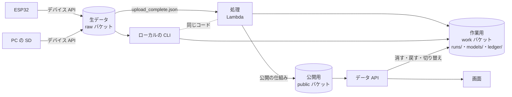

# データの流れの作り直し（設計）

- 2026-11-09 に決め、同じ日に本番をこの形に移した（Epic #1。処理の流れは `pipeline/src/ct125/flow.py` ほか）
- 元になった決定：#2（S3 の構成と書ける人）、#3（走行の分類）
- 構成図は [architecture.md](architecture.md)

## 1. ねらい

| 作り直す前の問題 | 作り直した後 |
|---|---|
| ローカル（`data/` の上で学習）と Lambda（S3 の上で推論）の 2 本の流れが、同じ本番の場所を書き換え合う | 処理は 1 本。ローカルでも Lambda でも、同じコードが S3 から読み、S3 に書く |
| `rides.json` の書き手が 3 つある（Lambda の差し替え・retrain・ローカルの `export --upload`） | 公開用に書けるのは「公開の仕組み」だけ |
| どの処理の結果を画面に出しているか分からない。前の結果に戻せない | 処理ごとに記録（`run.json`）を残し、台帳が「公開中の結果」を指す |
| 机上の試験も学習に入る | 走行を自動で分類し、学習に使う走行を台帳で選ぶ |
| モデルの作り方が残らない | 学習のたびに `model.json`（使った走行・設定・版）と `notes.md` を残す |

## 2. 全体の流れ



## 3. バケット（#2 の決定 A：役割ごとに別のバケット）

| バケット | 名前 | 中身 | 書ける | 保存期間 |
|---|---|---|---|---|
| 生データ | `ct125-logger-raw-<アカウントID>` | 機器・PC から届いた CSV と meta.json。正本 | デバイス API だけ | 期限なし（#24 で決定。消すのは admin の「完全に削除」のときだけ） |
| 作業用 | `ct125-logger-work-<アカウントID>` | 処理の結果と記録（`runs/`）、モデル（`models/`）、走行の台帳（`ledger/`） | 処理（Lambda・ローカル）。台帳はデータ API も | 期限なし（#24 で決定。1 回の処理で 1 走行あたり約 0.3 MB と小さい） |
| 公開用 | `ct125-logger-public-<アカウントID>` | 画面が読む JSON・PNG（公開中の結果だけ） | 公開の仕組み（処理の Lambda）だけ | 期限なし（いつでも作業用から作り直せる） |
| 画面 | `ct125-logger-<アカウントID>`（作り直す前からあるバケット） | React のビルド結果（`webapp/`）だけ | デプロイ（`web/scripts/deploy.ps1`） | — |

- どのバケットも、公開ブロック・SSE-S3・HTTPS のみ・バージョニング（古い版は 30 日）
- 作り直す前からあるバケットは名前を変えられないので、画面（CloudFront の配信元）用として残し、走行データは新しい 3 つに移した（12.）
- リージョンはプロジェクトのリージョン（ap-northeast-1）だけ

## 4. キーの置き方

```
raw バケット
  <ride_id>/accel.csv・gps.csv・events.csv・status.csv・meta.json・notes.md（または memo.txt）
  <ride_id>/upload_session.json   受け付けの記録（デバイス API）
  <ride_id>/upload_complete.json  完了の合図。これが置かれると処理が動く
  _uploads/<印>.json              送り終えた SD の走行の印（同じ走行を 2 回受け付けないため。#14。走行 ID の形でないので処理は数えない）

work バケット
  runs/<run_id>/run.json                          処理の記録（6.）
  runs/<run_id>/rides/<ride_id>/windows.parquet   1 秒窓の特徴量
  runs/<run_id>/rides/<ride_id>/scored.parquet    点数付きの窓
  runs/<run_id>/rides/<ride_id>/summary.json      一覧用の要約（rides.json の 1 件）
  runs/<run_id>/rides/<ride_id>/app/              画面用のファイル（ride_・spec_・wave_）
  models/<version>/baseline.json・isolation_forest.skops・model.json・notes.md
  models/current.json                             今使うモデルの版
  ledger/rides.json                               走行の台帳（7.）

public バケット
  datasets/shared/rides.json                      画面の走行一覧（台帳から作る）
  datasets/shared/ride_<id>.json・spec_<id>.png・spec_<id>.json・wave_<id>_<chunk>.json（生波形は約 1 分ごと）
```

- `run_id`：`<UTC の日時>-<6 桁の 16 進>`（例 `20261109T031500Z-3f9a1c`）。並べると時刻の順になる
- `version`（モデル）：`<UTC の日時>`（例 `20261109-031500`）。ローカルと Lambda でそろえる（作り直す前は YYYYMMDD と YYYYMMDD-HHMMSS が混ざっていた）
- 画面用のファイル名と中身は作り直す前と同じ（[web/docs/data_contract.md](../web/docs/data_contract.md)）。画面とデータ API は、読む場所が変わるだけ
- キーの置き方は、コードの 1 か所（pipeline・api の設定）にだけ書く

## 5. 処理（1 本の流れ）

| 命令 | きっかけ | すること |
|---|---|---|
| process | raw に `upload_complete.json` が置かれた／手で走行を指定 | 生データ → 前処理 → 分類 → 今のモデルで点数付け → 画面用の書き出し → work に保存 → 台帳を更新 → 公開 |
| retrain | 手で | 台帳で「学習に使う」走行だけで学習 → 新しいモデルの版 → 全走行を点数付けし直す → 公開 → `current.json` を切り替え |
| publish | 処理の後／データ API（消す・戻す・切り替え）の後 | 台帳が指す結果から公開用を作り直す（8.） |

- 計算（前処理・分類・点数付け・書き出し）は、ファイルを読み書きしない関数にする。保存は「保存の口」（S3 版と、テスト用のメモリ版）を通す
- ローカルの CLI と Lambda は、同じ処理を呼ぶ。違うのは、保存の口に渡す認証情報と、`run.json` の `where`（`local` か `lambda`）だけ
- ローカルにデータのフォルダーは置かない。作業は一時フォルダーで行い、終わったら消す

## 6. 処理の記録（`run.json`）

処理 1 回ごとに 1 つ。失敗しても理由と一緒に残す（作り直す前は Lambda のログにしか残らなかった）。

```json
{
  "schema": "run/2",
  "run_id": "20261109T031500Z-3f9a1c",
  "action": "process",
  "where": "lambda",
  "commit": "98d25dd",
  "started_at": "2026-11-09T03:15:00Z",
  "finished_at": "2026-11-09T03:15:19Z",
  "status": "succeeded",
  "error": null,
  "config": { "window_sec": 1.0, "classify": { "...": "..." }, "model": { "...": "..." } },
  "model_version": "20261107-143620",
  "rides": [
    { "ride_id": "ride_20261108_011304", "status": "succeeded", "kind": "idle", "kind_metrics": { "vib_median_g": 0.14, "gps_windows": 280, "max_dist_m": 12.0, "moving_windows": 0 }, "n_windows": 291, "n_anomalies": 0, "error": null }
  ]
}
```

## 7. 走行の台帳（`ledger/rides.json`）

走行ごとに 1 件。React 用の `rides.json` は、ここから作る。

| 項目 | 中身 |
|---|---|
| `ride_id` | サーバーが付けた走行 ID（`ride_<日時>`） |
| `original_name` | 上げ直す前の名前（`ride_004` など）。無ければ null |
| `device_id`・`local_session` | 記録した機器と、SD のセッション名（同じ走行の 2 回目の送信を見分ける。#14） |
| `kind`・`kind_metrics` | 分類と、その理由の数値（9.） |
| `deleted`・`deleted_at`・`deleted_by` | 画面で消したか。消しても生データと処理の結果は残す |
| `published_run` | 公開中の処理の結果（`run_id`） |
| `runs` | この走行を処理した `run_id` の一覧（新しい順） |

- 書き手：処理（新しい結果ができたら `published_run` を最新に）とデータ API（消す・戻す・前の結果に戻す）
- 同時に書いても壊れないよう、S3 の条件付き書き込み（ETag が変わっていなければ書く。変わっていたら読み直してやり直す）で更新する。走行が数百件までなら 1 つの JSON で足りる

## 8. 公開の仕組み

- 台帳を読み、**画面に出す走行**（消していない・机上でない）について、`published_run` の画面用ファイルを work から public にコピーし、`rides.json` を作り直す。出さなくなった走行のファイルは public から消す。走行のファイルは public の一覧から名前で探す（生波形は約 1 分ごとに分かれていて数が決まっていないため。古い形の `wave_<id>.json` も消す）
- public に書けるのはこの仕組みだけ（処理の Lambda の中で動く）。データ API は台帳を書き換えた後、処理の Lambda に `{"action": "publish"}` を非同期で渡す
- 前の結果に戻す ＝ 台帳の `published_run` を書き換えて publish。結果そのものは work に残っているので、計算し直さない

## 9. 走行の分類（#3 の決定 A：振動と GPS から自動で分類）

| 分類（`kind`） | 条件 | 画面 | 学習 |
|---|---|---|---|
| 机上（`desk`） | 振動の中央値が 0.05 g 未満（エンジンの振動が無い） | 出さない | 使わない |
| 停車（`idle`） | 振動があり、GPS のある窓が 60 以上で、始点から 200 m 以上動いていない | 出す | 使う |
| 実走（`ride`） | GPS で始点から 200 m 以上動き、5 km/h 以上の窓が 60 以上 | 出す | 使う |
| 実走（GPS なし）（`ride_nogps`） | 振動はあるが、GPS が足りなくて動いたか分からない | 出す | 使わない |

- 上から順に判定し、どれにも当たらないとき（GPS で 200 m 以上動いたが 5 km/h 以上の窓が少ない、など）は実走（GPS なし）にする（学習に使わない側に倒す）
- 「振動」は 1 秒窓の合成加速度の RMS（重力を除いたもの、`rms`）。しきい値を決めたときの 9 走行（2026-11-02 に記録）では、エンジン停止 約 0.015 g、アイドリング 約 0.13〜0.16 g、走行中 0.3 g 以上
- その 9 走行での確かめ（2026-11-09。名前は元の名前）：ride_006 は机上（0.015 g）、ride_001〜003 は停車（GPS の窓 84〜124、始点から 4〜19 m）、ride_004・005 は実走（約 2.3 km、5 km/h 以上の窓 468・543）、ride_007〜009 は実走（GPS なし）
- しきい値は `pipeline/config/default.yaml` の `classify` に置く。変えたら全走行を分類し直す
- 画面で消した走行は、分類にかかわらず学習に使わない
- 分類の結果と理由の数値を、台帳と `run.json` に残す

## 10. モデルの記録（#11）

`models/<version>/model.json`：版・日時・ローカルか Lambda か・コミット・ライブラリの版・設定・学習に使った走行と窓の数・使わなかった走行と理由・結果の要約（ベースラインのビンの数、異常の候補の数）・Isolation Forest の特徴量としきい値（`forest`。#81。分位点の割合と、学習の窓のスコアのその分位点）。
`models/<version>/notes.md`：要約を自動で書き、気づいたことを人が足す。
モデルを読むときに、学習したときのライブラリの版（skops を含む）と突き合わせ、違えば止める（版がずれると読めない・スコアが変わることがある）。

保存形式（#23 で決定、2026-11-10。#80 で実装）：Isolation Forest を pickle から **skops** に変えた（`isolation_forest.skops`）。pickle は読み込むと中のコードが動くので、`models/` に書ける人（処理の Lambda とローカルの処理のロール。どちらも `work/*` に書ける）が、処理の Lambda の中で好きなコードを動かせてしまうため。skops は読み込んでもコードが動かない。`baseline.json` は前と同じ JSON。
読むときは、skops が既定で信頼しない型のうち Isolation Forest に入っているもの（`sklearn.tree._tree.Tree`）だけを決め打ちで信頼し、それ以外の型が入っていれば止める（`pipeline/src/ct125/model.py` の `FOREST_TRUSTED_TYPES`）。ライブラリの版を上げて型が増えたら、確かめてから足す。
古い版の `.pkl` は読まない。`isolation_forest.pkl` しかない版を読もうとすると、学習し直す（retrain）よう伝えて止まる。pickle で保存した版は、学習し直して新しい版に切り替える（`use_model`）。

- 採用しなかった案：ONNX（推論に onnxruntime が要り、Lambda のコンテナが大きくなる。今の用途では利点が小さい）
- 採用しなかった案：pickle のまま権限を絞り、ハッシュを model.json で確かめる（ハッシュも同じ場所に置くので、書ける人はハッシュも書き換えられる）

## 11. 権限

| 誰 | raw | work | public | そのほか |
|---|---|---|---|---|
| デバイス API | 書く（署名付き URL）・受け付けの記録を読む | — | — | 機器のトークンのハッシュ（SSM）を読む |
| 処理の Lambda | 読む | 読む・書く | 書く | — |
| データ API | 完全に削除のときだけ、走行のフォルダー（`<ride_id>/` 以下）の一覧を取って消す。読めない | 台帳を読む・書く。`run.json` と `models/` を読む。完全に削除のときだけ `runs/<run_id>/rides/<ride_id>/` 以下を消す | 読む | 処理の Lambda を呼ぶ（publish だけ） |
| ローカルの処理（PC） | 読む | 読む・書く | **書けない** | — |
| デプロイ（PC の管理者） | すべて | すべて | すべて | Terraform を流す |

- データ API の消す権限は、ゴミ箱の「完全に削除」（#82。admin だけ）のためのもの。IAM で範囲を `raw の ride_*/*` と `work の runs/*/rides/ride_*/*` に絞り、`run.json`・`models/`・`ledger/`（台帳は書き換えで 1 件を除く）・`_uploads/` は消せない。消す順番は、台帳の 1 件を除いて公開し直しを頼む → 処理の結果 → 生データ（途中で失敗しても、画面に消えかけの走行が出ない）。バケットはバージョニングが有効なので、消したファイルの古い版は 30 日（`noncurrent_version_days`）残り、その後に消える
- ローカルの処理は、書ける範囲を絞った IAM ロール（`ct125-local-pipeline`）を、PC の CLI プロファイルから引き受けて使う。管理者のプロファイル（`ct125-logger`）は Terraform とデプロイにだけ使う
- 人のログイン（AWS Settings で管理）には手を加えない。ロールはこの処理のためだけに作る

## 12. 作り直す前のバケットからの移し方（#6・#15）

本番の画面を止めずに、足す → 写す → 切り替える の順で移した（2026-11-09）。前のバケットの中身は消さずに残したので、設定を戻せば前の流れに戻せる。前の状態の印は git のタグ `before-split-buckets`。

- 新しいバケット（raw・work・public）を足し、前の `raw/ride_001`〜`009` を写した
- 処理の Lambda・デバイス API・データ API を新しいバケットに向けた
- 9 走行をデバイス API から上げ直し（#15）、台帳に元の名前を残した

## 13. ローカルで出した結果の公開（#10）

ローカルの処理は work に結果を置くだけで、自動では公開しない。公開するときは `python -m ct125 publish --run <run_id>` で処理の Lambda に頼む（本番の画面を変えるのは、いつも同じ Lambda になる）。ローカルの学習し直しも、今使うモデルを切り替えない。

## 14. 決めたこと（2026-11-10）

次のことを決めた。

**走行の削除と保存期間（#24）**

- 走行を本当に消すのは、admin がゴミ箱の画面で「完全に削除」を押したときだけにする。消すのは、その走行の生データ・処理の結果・台帳の 1 件。生データは学習し直しに使うので、間違えて消さないことを優先する
- それまでのゴミ箱（台帳に印を付ける。戻せる。学習から除く）はそのまま残す
- 保存期間は、生データも処理の結果（`runs/`）も期限なし。決めたときの量（生データ 9 走行で約 105 MB）なら、保存の費用は月に数円。合計がたとえば 5 GB を超えたら決め直す。上書きされた古い版を 30 日で消す設定は変えない
- 採用しなかった案：ゴミ箱から一定の日数で自動で消す（戻せる期間が限られ、毎日動く処理が要る）
- 採用しなかった案：処理の結果だけ、台帳が指していないものを 180 日で消す（どれが指されているかを確かめて消す処理が要り、S3 の期限の設定だけでは済まない）

**利用者・機器ごとのデータの分け方（#25）**

- 分けない。全員が `datasets/shared/` を見る。車両が 1 台で、利用者も admin と見るだけの 1 人なので、分ける理由がない
- 利用者や車両が増えたら、`api/src/ct125_api/services/dataset_resolver.py` を差し替えて分ける
- 採用しなかった案：利用者ごとにデータセットを分ける（機器と利用者の紐付けが無く、台帳・処理・API・画面のすべてを直すことになる）

**test 環境（#26）**

- 作る（#83 で作った）。同じ Terraform を変数で 2 つにし、本番と test に分ける。それまでは、ローカルの process・retrain・publish と画面の dev:local が、すべて本番のバケットと Lambda に書いていたため
- 置き場所は本番と同じ AWS のプロジェクトの中で、名前で分ける（`ct125-test-…` など）。tfstate は別のキーにする。リージョンは本番と同じ選択済みリージョン
- 決め打ちの名前（`ct125-ride-pipeline`・`ct125-data-api`・`ct125-device-api`・`ct125-local-pipeline`・`ct125-app-users`・SSM の `/ct125/devices/` など）は変数にした（`infra/environment.tf`）。IAM は、test のロールが本番のリソースに届かないように、名前で範囲を絞る
- 採用しなかった案：作らない（つないだ動きの確かめが、本番への書き込みになる）
- 採用しなかった案：本番の中に test 用のデータセットを作る（Lambda そのものの入れ替えは、やはり本番に効く）
- 採用しなかった案：別のプロジェクトを作る（本番と確実に切り離せるが、プロファイル・ドメインの証明書・支出の上限をもう 1 組用意することになる）
- 作りと使い方は [test_environment.md](test_environment.md)（#83）。tfstate は Terraform の workspace で分ける（本番は default のまま）
