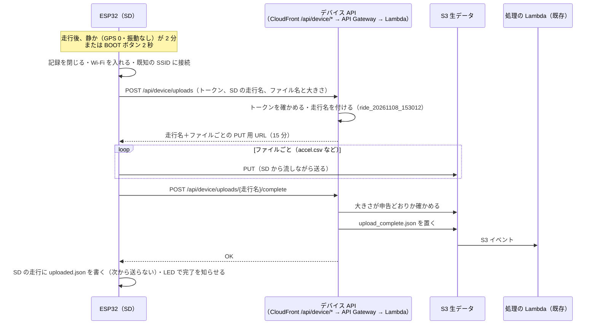

# ESP32 から S3 へ直接送る（設計）

作成：2026-11-08。サーバー側とファームウェア V3 を作り、2026-11-08 に机上で Wi-Fi から S3 へ送れることを確かめた。決めたことは末尾の「決めたこと」。

- 送信の手順の正式な定義：[contracts/upload/](../contracts/upload/)（送るファイル・必須のファイル・要求と応答の JSON・完了の印。CI が firmware・api・pipeline のコードと突き合わせる）
- ファームウェア：`firmware/ct125_logger/`（`uploader.cpp`・`config_store.cpp`・`root_ca.h`）。設定は `scripts/provision-device.ps1`

- サーバー側：`api` のデバイス API（`device_main.py`・`routers/device_upload_router.py` など）、`infra/device_api.tf`
- 機器の登録：`python -m ct125 register-device --id d01 --token-file d01.token`（ハッシュだけを SSM に置く）
- PC から送る道具：`python -m ct125 upload-sd`（`pipeline/src/ct125/device_upload.py`。ファームウェアと同じ手順を PC から行う）
- 同じ SD の走行は 2 回受け付けない（#14）：セッション名と必須のファイルの大きさが同じなら、送り終えた走行の ID を `status: already_uploaded` で返す（送るファイルは無い）。ESP32 はそのまま完了を報告し、「前に完了済み」を受け取って送り終えた印を付ける（firmware は変えていない）
- 確認：PC から機器のふりをして ride_001 を送り、受け付け → PUT → 完了 → 自動処理 → 公開一覧に載るまでを確認（その後、テストの走行と機器の登録は消した）

## 1. 目的

前は「SD を抜く → PC に挿す → PC から S3 に上げる」の手作業で、生データを上げていた。
この手作業をなくし、**走行の後に止めておけば、ESP32 が自分で S3 に上げ、処理の Lambda（生データが届いたときの自動処理）につながる**ようにする。

```
前：  ESP32 → SD →（人が PC へ）→ PC から上げる → S3 生データ → 処理の Lambda → 公開
後：  ESP32 → SD → ESP32 が Wi-Fi で S3 生データへ → 処理の Lambda → 公開
```

処理の Lambda の入口（生データのバケットに `<走行>/upload_complete.json` が置かれたら処理）はそのまま使う。**ここで作るのは「S3 に安全に置くところまで」**。

## 2. 前提（実機と、設計したときのファームウェアから）

| 項目 | 事実 | 設計への影響 |
|---|---|---|
| マイコン | ESP32-D0WD-V3、フラッシュ 4MB、PSRAM の有無は未確認（WROOM/WROVER 未確認） | TLS（約 40〜50KB）と記録用のリングバッファ（約 76KB）を同時に持つのは厳しい → **記録と送信は同時にしない** |
| 記録 | 電源オン＝新しい `/sessions/ride_NNN/`、1 秒ごとに flush。加速度タスクは core 0 | Wi-Fi のスタックも既定で core 0。記録中に Wi-Fi を動かすと 400Hz の取りこぼしの恐れ |
| データ量 | 約 15KB/秒（30 分で約 27MB、1 時間で約 55MB）。accel.csv がほとんど | API Gateway（本文 10MB まで）・Lambda（6MB まで）を通して送れない → **S3 に直接 PUT** |
| 電源 | cheero の USB バッテリー。車両バッテリーにはつながない | 走行の後も電源を切らなければ動き続けられる |
| 操作 | 走行中に操作できない。ボタンは増やさない | 自動で始める。手動は開発ボードの **BOOT ボタン（IO0）** を使う（部品を足さない） |
| 表示 | LED（IO2）だけ | 送信中・完了・失敗を点滅の形で出す |
| 走行の名前 | SD ごとに ride_001 から振り直す（別の SD の走行や、前に上げた走行と名前が重なる） | **名前はサーバーが付ける**（重ならないように） |

## 3. 方式の比較

### 3.1 いつ送るか

| 案 | 中身 | 良い点 | 問題 |
|---|---|---|---|
| **A. 止まったら送る（推奨）** | 走行後、電源を切らずに置く。GPS 速度 0・振動が静か（エンジン停止）が 2 分続いたら記録を閉じ、Wi-Fi を入れて既知の SSID を探し、あれば送る | 人の操作が要らない。記録と送信が重ならない | 信号待ち（エンジンがかかっている）と区別が要る → 「振動が静か」で見分ける（アイドリングの 20〜26Hz が消える） |
| B. 起動時に送る | 電源を入れたら、記録の前に未送信の走行を送る | 作りが単純 | 出発前に数分待たされる。待たずに走り出すと送れない |
| C. 走行中に送る | スマホのテザリングで少しずつ送る | 即時に見られる | 記録と同時に Wi-Fi・TLS を動かす（取りこぼし・メモリ）。電波が切れる区間の扱い。今は必要ない |
| 手動（A に足す） | BOOT ボタンを 2 秒押したら、記録を閉じて今すぐ送る | 確実に試せる（机上の確認にも使う） | ― |

→ **A＋手動（BOOT ボタン）**。C（走行中の送信）は将来。

### 3.2 どう認証して、どう送るか

| 案 | 機器に置く秘密 | 大きいファイル | ESP32 の実装 | 盗まれたとき |
|---|---|---|---|---|
| IAM のアクセスキーを機器に置き、署名（SigV4）して S3 に PUT | **長期の AWS の鍵** | ○ | 署名の実装が重い | 鍵を無効にするまで S3 に書ける。**不可** |
| API Gateway に POST → Lambda が S3 に置く | 機器用のトークン | ✕（10MB / 6MB の上限。分割と組み立てが要る） | 中 | トークンを無効にする |
| **署名付き URL（推奨）**：機器はトークンで API に「送りたい」と伝え、API が**その走行・そのファイル専用で 15 分だけ有効な PUT 用 URL** を返す。機器はその URL に S3 へ直接 PUT | 機器用のトークン（S3 の鍵ではない） | ○（1 回の PUT で 5GB まで） | 軽い（HTTPS の PUT だけ） | トークンを無効にする。トークンでできるのは「生データのバケットに新しい走行を置く」ことだけ。読めない |
| AWS IoT Core（X.509 証明書・相互 TLS）＋一時的な認証情報 | 機器ごとの証明書 | ○（ただし SigV4 が要る） | 重い（証明書の発行・配布、署名） | 証明書を無効にする |

→ **署名付き URL**。IoT Core は機器が増えたときの本命（台数が増えたら IoT Core の証明書に移す）。

## 4. 推奨する設計

### 4.1 全体



### 4.2 機器（ファームウェア）

| 部分 | 中身 |
|---|---|
| 状態 | `記録中` →（静か 2 分 or BOOT 2 秒）→ `送信` →（完了）→ `待機`（動き出したら新しい記録を始める） |
| 記録を閉じる | 電源を切ったときと同じ flush・close。リングバッファとタスクを止めてメモリを空けてから Wi-Fi を入れる |
| 送る対象 | `/sessions/ride_NNN/` のうち `uploaded.json` が無いもの（古い順） |
| 途中で切れたら | `upload_state.json`（サーバーが付けた走行名）を SD に残し、次回は同じ走行名で URL をもらい直してファイルごとにやり直す |
| 失敗したら | 30 秒・2 分・10 分…と間を空けてやり直す。動き出したら送信をやめて記録に戻る（記録が優先） |
| 秘密の置き場所 | Wi-Fi の SSID・パスワード（2 つまで。例：ふだんの Wi-Fi とテザリング）とデバイストークンは **NVS（ESP32 内部のフラッシュ）**。ソースにも SD にも置かない。USB シリアルから書き込む（利用者が入力） |
| TLS | ルート証明書（Amazon Root CA 1 など）を埋め込み、証明書を検証する（検証なしの接続はしない） |
| LED | 送信中＝2 秒に 1 回の長い点灯、完了＝点灯したまま、失敗＝3 回ずつの点滅 |

### 4.3 サーバー（AWS）

| 部分 | 中身 |
|---|---|
| デバイス API | `api` の `routers/device_upload_router.py`。Lambda は**画面用のデータ API とは別の関数**（`ct125-device-api`）にして、権限を分ける（画面用は生データを読めない、デバイス用は生データのバケットに置くだけ） |
| トークンの確認 | 機器は `Authorization: Device <機器ID>.<トークン>`。サーバーは SSM（`/ct125/devices/<機器ID>/token-sha256`）のハッシュと定数時間で比べる。トークンそのものは保存しない |
| 走行名 | サーバーが付ける：`ride_<受け付けた日時 JST の年月日>_<時分秒>`（例 ride_20261108_153012）。重なったら末尾に `_2`・`_3`… |
| 受け付ける中身 | ファイル名は accel.csv・gps.csv・events.csv・status.csv・meta.json と、走行メモ（notes.md。古い名前の memo.txt・readme.txt）だけ。必須は accel.csv・gps.csv・meta.json。大きさの上限（1 ファイル 200MB） |
| 完了の確認 | S3 の大きさが申告と一致したら `upload_complete.json` を置く（処理の Lambda が動く）。一致しなければ 409 を返し、機器はやり直す |
| 後から書いた走行メモ（#100） | 送り終えた走行でも、送ってきた走行メモ（notes.md・memo.txt・readme.txt）が S3 に無いか大きさが違えば、start は `status=memo_added` でメモの分だけ URL を返し、`upload_addition.json` に記録する。メモを足した機器が complete を呼ぶと大きさを確かめ、`upload_complete.json` の files にメモを足して `memo_added_at` を付けて置き直す（処理の Lambda がもう一度動き、メモが画面と台帳に出る）。最初に送った機器でなくてよい（ESP32 で送り、PC で書いたメモを `upload-sd` で足す）。メモ以外のファイルは上書きできないまま。大きさで見分けるので、大きさが同じまま中身だけ変えたメモは足せない |
| 機器の登録 | `python -m ct125 register-device --id d01`：トークンを作り、ハッシュを SSM に置き、トークンは画面に 1 回だけ出す（利用者がシリアルで機器に入れる） |
| 無効化 | SSM のパラメーターを消せば、その機器は送れなくなる |
| Terraform | Lambda・IAM（生データのバケットへの PutObject と大きさの確認だけ）・API Gateway のルート `POST /api/device/{proxy+}`（JWT なし、秒間 2 件まで）・CloudFront の `/api/*` で POST を許す |

### 4.4 守ること

- 機器に AWS の鍵を置かない。トークンでできるのは「生データのバケットに新しい走行を置く」ことだけ（読めない・消せない・上書きできない）
- 生データは非公開の生データのバケットだけ。公開されるのは処理の Lambda が処理した後の画面用データ（ログインした人だけが見られる）
- 記録が送信より優先。送信のせいで記録を取りこぼさない（同時に動かさない）
- Wi-Fi のパスワードとトークンの入力は利用者が行う

## 5. 決めたこと

1. **送るきっかけ**：A（止まって静かになったら自動）＋ BOOT ボタン → 決定（2026-11-08）
2. **Wi-Fi**：**2.4GHz の SSID** を使う → 決定（2026-11-08）。ESP32 は 5GHz に対応しないので、5GHz の SSID は使わない。SSID とパスワードはリポジトリに書かず、利用者がシリアルから NVS に書き込む。テザリングは未定
3. **BOOT ボタン**：ブレッドボードに挿した状態で押せる → 決定（2026-11-08）。2 秒押しで今すぐ送る
4. **走行名**：`ride_<日時>`（例 ride_20261108_153012）→ この形にした（前の ride_001〜009 は、上げ直したときに元の名前として台帳に残した）
5. **進め方**：まずサーバー側を作り、PC から機器のふりをして確かめる → この順で進める
