# 構成図（2026-11-06 時点）

実線＝今回実装したもの、点線＝設計のみ（今後の拡張、`docs/DEV_PLAN.md` フェーズ 5）。

```mermaid
flowchart LR
    subgraph bike[バイク側（実装済み・動作確認済み）]
        GPS[ATGM336H GPS<br/>9600bps・1Hz] --> ESP[ESP32<br/>CT125_LOGGER_V2.1]
        ACC[ADXL345 振動<br/>400Hz・±16g] --> ESP
        ESP --> SD[(microSD<br/>accel.csv / gps.csv / events.csv / status.csv)]
    end

    SD -->|今回: PC へ手動コピー| RAWL[(data/raw/)]
    SD -.->|将来: テザリング経由 HTTPS| API[API Gateway + Lambda] -.-> RAW

    RAWL --> IO[io / clean<br/>t_us→JST、品質フィルタ、振り切れ]
    IO --> FEAT[features / gps<br/>1秒窓: rms, p2p, crest, jerk, 帯域比<br/>GPS 補間・自宅マスク]
    FEAT --> WIN[(data/processed/<br/>windows.parquet)]
    WIN --> MODEL[model<br/>速度補正ベースライン z_speed<br/>Isolation Forest score_if]
    MODEL --> SC[(scored.parquet)]
    SC --> VIZ[viz<br/>folium 地図 + Plotly タイムライン]
    VIZ --> WEB[(web/<ride_id>/index.html)]

    RAWL -->|upload| RAW[(S3 raw/)]
    WIN -->|upload| PROC[(S3 processed/)]
    WEB -->|upload| SITE[(S3 site/)]
    SITE -->|署名付き URL| USER[ブラウザ]

    RAW -.->|将来: S3 イベント| LPROC[Lambda 前処理] -.-> PROC
    PROC -.->|将来| SM[SageMaker Processing / Training<br/>再学習・contamination 調整] -.-> MODEL
```

## 今回実装したもの

| 段階 | 実装 | 場所 |
|---|---|---|
| 記録 | ESP32 Arduino スケッチ（V2.1）。GPS と加速度を別 CSV、時計は `t_us` | `firmware/ct125_logger/` |
| 読み込み・時刻 | `t_us` と GPS UTC の対応付け、JST | `src/ct125/io.py` |
| クリーニング | 重複・振り切れ、GPS の status/sats/hdop/飛び/速度不整合 | `src/ct125/clean.py` |
| 特徴量 | 1 秒窓の振動特徴量、帯域比 | `src/ct125/features.py` |
| GPS 結合 | 速度の平滑化、窓中心への補間、自宅マスク | `src/ct125/gps.py` |
| スコア | 速度補正ベースライン、Isolation Forest | `src/ct125/model.py` |
| 可視化 | 地図＋タイムラインの静的 HTML、GPS 欠損時フォールバック | `src/ct125/viz.py` |
| AWS | S3 アップロード、署名付き URL | `src/ct125/aws.py`、`docs/aws_setup.md` |

## 設計のみ（今回は実装しない）

- テザリング経由の自動送信（ESP32 → API Gateway → Lambda → S3 raw/）
- S3 イベントで Lambda が前処理、SageMaker での再学習
- Google Maps JavaScript API への差し替え（TypeScript フロント）
- ECU 系統：端子・電圧・プロトコルが未検証で、今は安全に検証できないと判断し、今回は触れていない
