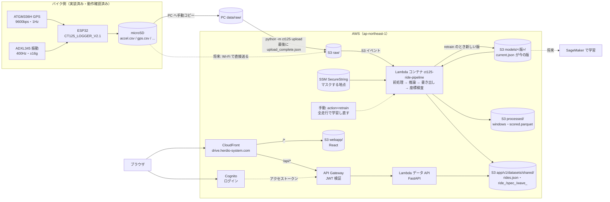

# 構成図（2026-11-07 時点）

実線＝実装済み、点線＝設計のみ（今後の拡張）。

## 実装したもの

| 段階 | 実装 | 場所 |
|---|---|---|
| 記録 | ESP32 Arduino スケッチ（V2.1）。GPS と加速度を別 CSV、時計は `t_us` | `firmware/ct125_logger/` |
| 読み込み・時刻 | `t_us` と GPS UTC の対応付け、JST | `src/ct125/io.py` |
| クリーニング | 重複・振り切れ、GPS の status/sats/hdop/飛び/速度不整合 | `src/ct125/clean.py` |
| 特徴量 | 1 秒窓の振動特徴量、帯域比 | `src/ct125/features.py` |
| GPS 結合 | 速度の平滑化、窓中心への補間、自宅マスク | `src/ct125/gps.py` |
| 前処理の本体 | 上の 4 つを 1 走行分まとめる（CLI と Lambda の両方から使う） | `src/ct125/processing.py` |
| スコア | 速度補正ベースライン、Isolation Forest。学習（`fit_models`）と推論（`apply_models`）を分けてある | `src/ct125/model.py` |
| 画面用データ | rides.json・ride_<id>.json・スペクトログラム・生波形。1 走行ずつ書き出せる（`export_ride`） | `src/ct125/export.py`・`spectro.py` |
| AWS の処理 | S3 に生データが届いたら Lambda（コンテナ）が前処理 → 推論 → 書き出し → 座標検査 → 公開。手動で学習し直し | `src/ct125/cloud/`、`deploy/lambda/`、`scripts/build-pipeline-image.ps1` |
| 公開 | CloudFront＋Cognito ログイン＋データ API（FastAPI） | `D:\ct125-app`（フロントと `api/`） |
| AWS のリソース | S3・CloudFront・Cognito・API Gateway・Lambda×2・ECR・ACM（Terraform） | `D:\ct125-logger-terraform` |

## 自宅周辺の座標を出さない仕組み（AWS 側）

- マスクする地点は SSM パラメーターストアの SecureString（`/ct125/private-points`）。値は `python -m ct125 sync-private-points` が `config/local.yaml` から座標だけを上げる。Terraform もコンテナも値を持たない
- Lambda は地点が読めなければ処理を止める（マスクせずに書き出さない）
- 書き出した JSON に地点から半径 300 m 以内の座標があれば、S3 に上げずに止める（ローカルの `export` と同じ検査）

## 設計のみ（今後）

- ESP32 から Wi-Fi で S3 に直接送る（今は SD を PC に挿して `upload`）
- SageMaker での学習（今は Lambda の `retrain` で十分な量。データが増えたら移す）
- ユーザーごとのデータセット（入口は `D:\ct125-app\api\src\ct125_api\services\dataset_resolver.py`。今は全員 shared）
- ECU 系統：端子・電圧・プロトコルが未検証で安全に検証できないと判断し、触れていない
